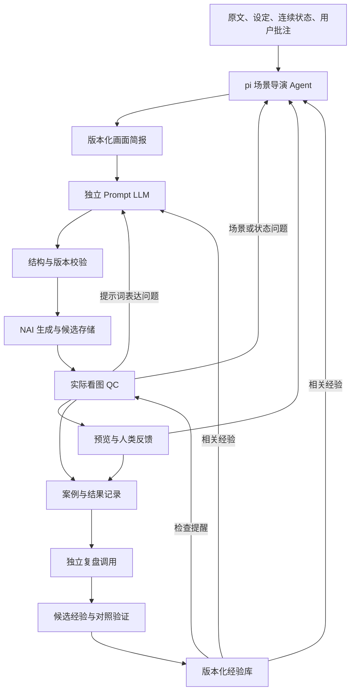

# 基于 pi 的 NAI 场景导演与学习优化系统需求

- 文档版本：0.1
- 整理日期：2026-10-16
- 状态：需求讨论稿；描述目标行为，不代表已经实现或验证。
- 来源：本次关于 pi、独立 Prompt LLM、上下文分工、QC 与学习优化的连续讨论。
- 当前保存位置：原 NAI 项目的 `docs`，用于记录需求；不据此迁移生产数据或调整现有服务。

## 1. 背景与问题

现有生图工作方式存在两类问题：

1. 通用 Agent 基于 Skill 操作 NAI，能够贯穿创作过程，但步骤遵守不稳定，容易遗漏用户批注、逐图 QC、版本核对或返修收尾。
2. 人物提取、场景切片、场景描述、Prompt 编写分别调用 LLM，便于控制步骤，但上下文在模块间被截断，创作意图和连续性判断容易丢失。

目标是同时保留持续的全局理解与局部任务的专注度，并让必要步骤由程序保证执行。随着生产积累，还应复盘 QC 失败和人类反馈，使后续任务能够使用经过验证的经验。

## 2. 讨论方向与决策状态

| 项目 | 当前状态 | 说明 |
| --- | --- | --- |
| pi 承载场景导演 Agent | 用户提出的目标方向 | 用于原文理解、场景切片、场景描述及连续状态维护；具体 SDK 版本待实施时固定 |
| 单张 Prompt 由独立 LLM 编写 | 用户明确提出的架构方向 | 导演提交画面简报，独立请求完成完整 Prompt |
| 增加复盘学习优化层 | 用户提出的目标能力 | 利用 QC 样本和人类指出的问题持续改进 |
| 一个有状态导演配合局部无状态调用 | 推荐方案 | 独立 Prompt 请求默认按张隔离；不足信息由导演补充 |
| 程序保证必要执行步骤 | 推荐实现原则 | 批注扫描、版本检查、状态推进、次数与预算等不只依赖 Skill |
| 经验先作为外部记忆与版本化策略 | 推荐实施顺序 | 第一阶段不训练模型权重；有效性由对照评估确认 |
| 具体实现目录 | 待落地决定 | 倾向基于独立的 `D:/antigravity/nai-agent-studio` 扩展，保留原项目与数据边界 |

本稿把推荐方案展开为可评审需求。模型选择、阈值、状态名和接口名属于候选设计，不视为已经冻结的实现协议。

## 3. 目标与边界

### 3.1 目标

- 导演持续掌握剧情、人物、画面意图和用户反馈。
- Prompt LLM 只接收足以编写当前画面的相关信息，减少无关历史。
- 导演会话只接收必要的工具结果摘要，避免完整 Prompt 和重试日志持续堆积。
- 生图、看图 QC、返修、反馈处理、阶段交付形成持久化闭环。
- 失败能够定位到相应责任层，修正不必全部转化为追加标签。
- 经验能够按条件检索、验证、生效和回滚，并保留证据来源。

### 3.2 边界

- pi 提供 Agent 运行基础；领域工具、状态机、上下文装配和质量标准由本系统实现。
- “学习”第一阶段指案例记忆、经验提炼、检索与策略调整，不等于模型权重自动更新。
- 本需求不包含立即实施、批量生成、迁移生产数据或模型训练。
- 继续区分生成完成、Agent QC、人类反馈、人工批准和最终交付；学习层不替代人工决定。
- 完整 Prompt 的创作主体仍是 LLM；程序负责装配输入、校验、存储与调度，不以模板拼接替代核心创作。

## 4. 总体架构

这里的“独立调用”描述上下文隔离，不要求使用不同模型，也不要求每个模块都是长驻 Agent。

## 5. 职责分工

| 组件 | 主要职责 | 输出与限制 |
| --- | --- | --- |
| pi 导演 Agent | 理解原文、切片、选择时点、描述画面、维护连续性、处理用户意见 | 输出画面简报及必要的状态变更，负责语义上的最终决定 |
| Prompt LLM | 将简报写成完整 NAI Prompt；修正表达错误 | 默认单张独立请求；发现关键缺项时返回结构化补充请求 |
| 上下文装配器 | 从权威记录读取相关事实、规则、反馈和经验 | 程序组装信息包，保留来源、作用域和版本 |
| 执行控制层 | 顺序、版本、幂等、次数、预算、暂停恢复及状态推进 | 不依赖模型自然语言承诺判断完成 |
| NAI 适配器 | 提交请求、追踪结果、保存参数与候选 | 跟踪在途请求，不因超时重复发起付费生成 |
| 视觉 QC | 根据原文、当前状态、用户要求和实际图片给出证据 | 必须接收图像内容，文本或文件校验不能替代看图 |
| 复盘学习层 | 归因、提炼候选经验、组织验证、维护经验生命周期 | 独立于生产会话，不自行覆盖原始证据或批准结果 |
| 预览与反馈台 | 展示产物、接收批注和用户决定 | 保存用户意见原文，反馈与审批分别建模 |

## 6. 场景导演需求

### FR-D01 原文理解与切片

- 按完整章节理解情节，按需查阅前章与其他原文。
- 每张画面选择一个可定格的主要时点，避免同时描述动作起点与终点。
- 保存原文定位、逐字引用、故事事件、当前可见状态和覆盖说明。
- 区分原文事实、用户要求、创作建议与不确定信息。

### FR-D02 连续性管理

- 维护人物稳定外观、当前服装、地点、道具归属、空间与事件进展。
- 状态变化带来源和版本，支持跨章节交接。
- 章节新会话通过状态和交接记录恢复，不要求把整本小说始终放在同一会话。
- 下游发现简报矛盾时，由导演修正语义，不交给 Prompt LLM 自行猜补。

### FR-D03 反馈落实

- 生成前、生成后与恢复任务时检查新增反馈。
- 新反馈按作用域路由到当前图、其他待返修图、后续章节或作品设定。
- 区分已读取、待处理、已处理及处理结果，避免把读取游标当完成标志。
- 用户叫停后，控制层立即停止续发；仅向会话插入“停止”消息不足以保证停止收费请求。

## 7. 画面简报与 Prompt LLM

### 7.1 画面简报内容

| 内容 | 要求 |
| --- | --- |
| 身份与版本 | 项目、章节、sceneId、简报版本、inputHash、规则版本 |
| 原文依据 | 当前片段、必要前后文、逐字 quote 与定位 |
| 当前时点 | 单一时点的动作阶段、姿态、表情、人物与物件状态 |
| 画面意图 | 要表达的事件、关系或情绪 |
| 人物信息 | 稳定人物 ID、可见外观、当前服装、人物段顺序 |
| 连续性信息 | 与当前画面相关的前序状态、前图衔接和有效设定 |
| 约束等级 | 原文事实、用户硬要求、可调整构图偏好分别标记 |
| 生成规范 | 风格、画幅、NAI 目标版本、相关 Prompt 写作规则 |
| 反馈与经验 | 当前有效的相关批注、返修目标、少量适用经验 |
| 不确定信息 | 缺失项、冲突项与允许创作的范围 |

简报应足够完成单张创作，同时保留原文依据。缩短输入不以牺牲关键事实为代价。

### FR-P01 独立编写

- 每张默认新建独立上下文，由固定写作规范和当前信息包组成。
- 允许导演与 Prompt LLM 使用同一个模型的不同请求；模型分工效果单独评估。
- 默认输出完整正负 Prompt、人物分段及后端需要的相关字段，具体 schema 待实现冻结。
- 缺少关键状态或出现矛盾时返回结构化缺项；补齐后重新编写。
- 保存完整请求、输出、模型和规则版本，供复盘与复现。

### FR-P02 校验与局部返修

- 程序检查格式、必要字段、人物对应、版本、规则冲突及长度提示。
- 精确 token 统计与启发式估算必须区分。
- Prompt 校验通过不等于语义正确，也不等于最终图片通过。
- 修正时携带当前版本、失败证据和已解决项，避免无关内容反复重写。

### FR-P03 控制回传内容

- 工具接口可采用 `generate_prompt(sceneId, revision)` 一类形式，程序从存储读取完整输入。
- 导演默认收到产物引用、版本、校验摘要和待处理问题。
- 完整 Prompt、过程日志及历史尝试外部保存，按需读取。

## 8. 上下文管理

| 层次 | 内容 | 读取方式 |
| --- | --- | --- |
| 项目长期状态 | 人物、选角、风格、用户要求、已确认设定 | 持久化，按当前任务选取 |
| 章节工作状态 | 完整原文、事件推进、覆盖、服装与道具变化 | 章节理解时读取，跨章交接 |
| 单张上下文 | 简报、出处、当前人物、相关前图、返修信息 | 精确绑定当前版本 |
| 近期会话 | 当前决策和必要工具结果 | 保留近期过程，定期压缩 |
| 经验库 | 案例、候选经验、有效策略及反例 | 按阶段与条件检索 |

- 权威事实来自版本化项目记录；会话摘要用于辅助恢复。
- 经验、日志和全部历史 Prompt 不持续追加到主会话。
- 上下文注入应可追踪，能够解释一次调用读取了哪些版本和经验。
- 输入长度减少、注意力改善、质量提升是不同指标，分别观察。

## 9. 生成、QC 与返修闭环

### FR-Q01 生成与证据

- 生成请求绑定简报、Prompt、模型和参数版本。
- 保存独立候选、请求标识、时间、图片哈希和输入哈希。
- 当前候选和必要前图实际进入视觉模型输入；模型接收图片不等于判断一定准确。
- QC 逐项保留证据与不确定项，当前 C1–C12 协议是否沿用以实际实现为准。
- 图片、相关输入或参考上下文变化使旧 QC 失效。

### FR-Q02 分层返修

| 问题 | 处理路径 |
| --- | --- |
| 标签重复、人物段错位、表达遗漏 | Prompt LLM 修正 |
| 剧情时点错误、人物状态矛盾、空间关系未定义 | 导演修改简报 |
| 生图偶发结构缺陷 | 按预算重抽或调整表达，并保留结果 |
| QC 对合理画面误判 | 检查审核依据与标准适用，不改写历史报告 |
| 人类新增要求 | 更新相应作用域的状态，重新确定受影响产物 |

### FR-Q03 完成与中断

- 当前轮次的次数和预算由程序管理，具体上限继承项目配置或用户要求。
- 达到上限后保留候选、真实 QC 和待处理原因，进入明确的待处理状态。
- 完成检查覆盖指定范围内的图、QC、反馈、失败与交付条件。
- 中断恢复时先核对在途请求和已保存结果；不因失败状态推断未扣费或自动重投。
- 人工重抽候选等特殊路径保留自身审核规则，不统一强制转成普通 Agent QC。

## 10. 复盘与学习优化层

### 10.1 第一阶段定位

学习层通过案例、归因、经验和评估改变后续输入与策略。先实现可追溯的外部经验管理，积累足够干净的样本后，再评估微调或偏好训练。

### FR-L01 案例记录

每次生产与返修记录形成关联链：

`原文/简报 → Prompt → 生成请求 → 候选 → QC/人类意见 → 修改 → 新候选 → 结果`

记录内容至少包括：

- 各产物及版本、哈希、关联 ID。
- 实际生成模型、参数、seed、参考图与输出图。
- QC 证据、人类意见原文、反馈的作用域。
- 本次修改的具体差异，以及哪些条件同时发生变化。
- 最终采用、退回、待处理等用户或流程决定。
- 导演、Prompt 和 QC 使用的模型、规则与经验版本。

成功与失败样本均保存；失败后的成功结果需要关联到同一返修链。

### FR-L02 复盘与归因

- 复盘采用独立调用，生产 Agent 不接收整段复盘历史。
- 归因区分原文理解、简报、Prompt 表达、生成波动、QC 误判和审美偏好。
- 区分可观察事实、原因假设和验证结论；允许暂不确定原因。
- QC 失败是待解释的观察，不自动证明 Prompt 有错。
- 仅换 seed 后成功不自动证明新的写法有效。
- 问题路由回相应责任层，避免所有失败都处理为追加 Prompt 标签。

### FR-L03 人类反馈分级

| 类型 | 生效方式 |
| --- | --- |
| 明确的当前图修正 | 直接进入当前任务返修 |
| 明确的作品长期要求 | 写入该作品的偏好或设定，并保留来源 |
| 从意见推断出的偏好 | 作为候选，保持推断标记与有限作用域 |
| 从失败推断出的技术原因 | 进入验证流程 |

原始反馈不可被总结覆盖；经验不得覆盖更新的用户要求或权威剧情事实。

### FR-L04 经验表示与作用域

每条经验至少包含：

- 经验 ID、版本、状态、创建来源。
- 问题类型、适用条件、例外与不适用范围。
- 作用对象：导演、Prompt、QC 或执行流程。
- 建议行为、支持案例、反例与不确定性。
- 适用作品、用户偏好、画风、模型和规则版本。
- 验证记录、实际使用记录与回滚记录。

建议生命周期为：`待验证 → 试用 → 有效 → 退役/回滚`。状态名可调整，但原始案例、候选结论与正式生效策略必须区分。

### FR-L05 对照验证

- 使用固定场景集，包含目标问题场景和原本正常的场景。
- 留出未参与经验提炼的场景，用于检查可推广性。
- 尽量保持模型、参数和参考条件一致，使用多个 seed；保存无法完全控制的差异。
- 同一场景的相似重试不全部当作独立证据。
- 观察问题减少、原文符合度、连续性、采用率、重试次数、成本与新增缺陷。
- 仅在相关范围验证通过后启用；样本有限时明确标为试用。
- 离线 Prompt 检查只能验证表达或结构；图像改进需要实际生图与视觉评价。
- 新策略先有限应用，发现退化时可恢复旧版。

### FR-L06 避免自我评价失真

- 保留固定评估标准和人类评价，避免以放宽 QC 获得更高通过率。
- 学习层可以提出 QC 修正建议，标准变更单独版本化并评估。
- 经验只在符合条件时生效，单一作品偏好不自动升级为全局规则。
- 记录失败、反例和退化，不只保留成功案例。

### FR-L07 按需检索

- 导演读取切片、状态与构图经验；Prompt LLM 读取相关动作和表达经验；QC 读取易错点提醒。
- 经验提醒不替代完整 QC 标准。
- 控制数量与 token 预算；初始可尝试最多三条简短经验、一个对照案例，随后实测调整。
- 第一版可用结构化标签和规则筛选，不强制引入向量数据库。
- 每次使用记录命中的经验版本，支持排查与回放。

## 11. 建议接口与数据实体

以下为逻辑接口示例，正式名称和 schema 在实现阶段确定。

| 操作 | 目的 |
| --- | --- |
| `context.load` | 读取当前有效状态、反馈和相关经验 |
| `scene.plan` / `scene.revise` | 保存导演简报与状态变化 |
| `prompt.generate` / `prompt.revise` | 调用独立 LLM，保存完整产物 |
| `render.submit` / `render.status` | 幂等提交与结果追踪 |
| `qc.evaluate` / `qc.record` | 组织实际视觉请求并保存证据 |
| `feedback.scan` / `feedback.resolve` | 读取反馈与保存落实结果 |
| `case.record` / `case.reflect` | 形成案例链并提出归因和候选经验 |
| `experience.retrieve` | 检索当前适用经验 |
| `experience.evaluate` / `experience.activate` / `experience.rollback` | 验证、启用与恢复策略 |

核心实体建议包括：ProjectState、ChapterState、SceneBrief、PromptArtifact、RenderAttempt、Candidate、QCReport、HumanFeedback、Case、Experience、EvaluationRun、PolicyVersion。

所有关键写入支持版本冲突检测；外部副作用有稳定操作标识。状态存储与会话存储分别管理，但能通过产物 ID 和版本互相追踪。

## 12. 与现有项目的衔接

- 原 `D:/antigravity/nai` 可作为现有模块和 API 的参考，是否复用后端取决于最终实现目录与隔离要求。
- 独立 `D:/antigravity/nai-agent-studio` 已有原文、场景/Prompt、连续状态、候选、QC、预览与批注相关能力，优先评估复用。
- 独立 Studio 当前的 `render-request` 负责导出输入，付费请求适配器需单独设计；不把导出请求误认成已有生图服务。
- 实施前重新核对实际代码、Skill 和当前数据协议，不以历史记录替代现状验收。
- 固定 pi 版本及依赖，使用该版本的 SDK、扩展和会话协议。
- 本稿不修改现有生产脚本、运行配置、项目记录或 Skill。

## 13. 实施阶段建议

| 阶段 | 交付重点 | 验证目标 |
| --- | --- | --- |
| 1 | pi 导演、结构化简报、独立 Prompt 调用 | 全局理解与局部表达能够衔接，结果版本可追溯 |
| 2 | NAI、视觉 QC、反馈、暂停恢复与预算闭环 | 必要步骤由程序落实，中断不重复付费生成 |
| 3 | 案例链、反馈归类、独立复盘、候选经验库 | 失败能复盘，建议有来源与作用域 |
| 4 | 对照评估、经验检索、策略启用与回滚 | 改进可测量，退化可恢复 |
| 5 | 评估微调、偏好训练及更复杂检索 | 仅在样本质量和实际收益支持时引入 |

## 14. 验收场景

| 编号 | 验收情境 | 预期结果 |
| --- | --- | --- |
| AC-01 | 同一章节分别由导演直接写 Prompt、独立 LLM 写 Prompt | 保存相同条件下的输入、采用结果、遗漏、返修与成本，能够比较 |
| AC-02 | Prompt 编写期间发现人物服装冲突 | 返回缺项或冲突，导演修正简报，旧版本不继续执行 |
| AC-03 | 当前图完成时出现另一张图的新批注 | 保存待处理项并按影响范围路由，不丢失或误标完成 |
| AC-04 | Prompt、图片或相关前图更新 | 原 QC 过期，新报告绑定当前实际输入 |
| AC-05 | 生成提交后超时或服务重启 | 保留请求记录，先核对结果再决定后续操作，无盲目重复提交 |
| AC-06 | 达到重试上限或用户叫停 | 停止续发，展示在途状态、候选及待处理原因 |
| AC-07 | 同一问题经修改后成功 | 关联修改前后样本，经验保持候选状态直到完成相应验证 |
| AC-08 | 用户提出单作品审美要求 | 仅对该作品生效，来源可查，不污染其他作品 |
| AC-09 | QC 误判合理画面 | 复盘识别审核问题，保留原报告及新结论，标准变化单独记录 |
| AC-10 | 新经验改善目标场景却损害正常场景 | 评估显示退化，暂缓推广或缩小作用域，支持回滚 |
| AC-11 | 长任务积累大量日志和案例 | 调用仍仅装入相关上下文，完整记录可按引用查回 |

以上是实施后的行为验收要求，不表示本轮已经执行这些测试。

## 15. 待验证假设与开放项

- 独立 Prompt 调用是否提高质量，需与同模型、相同素材基线比较。
- 上下文缩短是否减少遗漏，需同时统计输入长度和实际任务质量。
- 导演、Prompt、QC、复盘是否使用不同模型，待同条件评估决定。
- 视觉 QC 的承载方式、模型能力与成本尚需选择。
- 简报 schema、经验 schema、状态名、预算、检索阈值和经验启用标准尚需冻结。
- 初始评估集规模、跨作品隔离方式、规则冲突处理顺序需实施时明确。
- pi 会话恢复与业务请求恢复需分别设计；会话恢复不代表远程请求可重放。
- 待确定实施目录后，再决定复用哪些现有模块以及如何接入预览台。

## 16. 参考资料

以下资料用于说明框架能力或方法来源，不构成 NAI 场景效果已被证明的证据。正式实施时以固定版本代码和实际对照结果为准。

- [pi 上游](https://github.com/earendil-works/pi)
- [pi Agent Core](https://github.com/earendil-works/pi/blob/main/packages/agent/README.md)
- [pi SDK](https://github.com/earendil-works/pi/blob/main/packages/coding-agent/docs/sdk.md)
- [pi 扩展](https://github.com/earendil-works/pi/blob/main/packages/coding-agent/docs/extensions.md)
- [pi 上下文压缩](https://github.com/earendil-works/pi/blob/main/packages/coding-agent/docs/compaction.md)
- [Lost in the Middle: How Language Models Use Long Contexts](https://arxiv.org/abs/2307.03172)
- [Reflexion: Language Agents with Verbal Reinforcement Learning](https://arxiv.org/abs/2303.11366)
